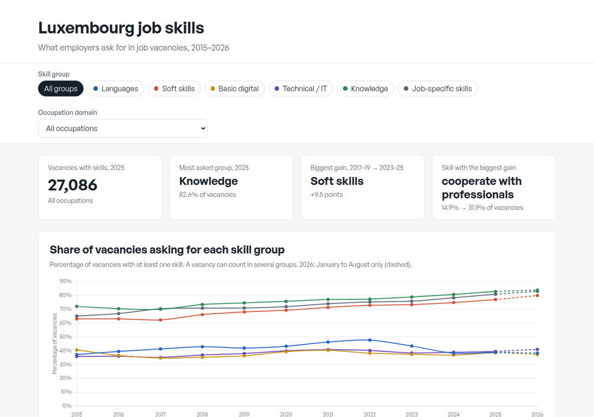

# Luxembourg job skills, 2015–2026

Which skills do employers in Luxembourg ask for, and how has that changed? This project uses about 276,000 job vacancies with detected skills, sent to ADEM (the Luxembourg public employment service) from 2015 to 2026. It sorts every skill into six groups and publishes the results as a small interactive website.

**Live website:** https://YOUR-USERNAME.github.io/luxembourg-job-market/



## What the website shows

- Pick a **skill group** (or all of them) and an **occupation domain**.
- See how the share of vacancies asking for each group changed from 2015 to 2026.
- See the **top skills** in the group, plus the skills that are **growing** or **declining** most.
- Compare any skills over time (for example Python, SQL or German).

Skill groups:

| Group | Examples |
|---|---|
| Languages | English, French, German |
| Soft skills | communication, work in teams, adapt to change |
| Basic digital | use Microsoft Office, use e-mail |
| Technical / IT | SQL, Python, computer programming |
| Knowledge | accounting, economics, computer science |
| Job-specific skills | everything else, tied to a particular job |

## Some results

- Soft skills: asked for in 62.9% of vacancies in 2015 and 76.8% in 2025.
- "Cooperate with professionals" grew the most: from 14.9% of vacancies in 2017–2019 to 31.9% in 2023–2025.
- Knowledge was the most-asked group in 2025 (82.6% of vacancies).

## Project structure

```
luxembourg-job-market/
├── notebooks/                 the analysis, run in order 01 → 05
├── data/
│   ├── raw/                   ADEM CSV files (not in GitHub, download them)
│   ├── processed/             clean tables made by the notebooks (not in GitHub)
│   └── reference/
│       ├── esco/              ESCO v1.2.1 CSV files (not in GitHub, download them)
│       └── skill_category_overrides.csv   manual group corrections
├── outputs/                   charts and CSV results from notebooks 03 and 04
├── docs/                      the website (published by GitHub Pages)
│   ├── index.html, style.css, app.js
│   └── data/dashboard.json    data for the website, made by notebook 05
├── requirements.txt
└── README.md
```

## Notebooks

| Notebook | What it does | Main output |
|---|---|---|
| `01_data_checks` | Loads the six raw files and checks rows, vacancies, months covered, duplicates and missing values. Changes nothing. | Notes that decide the cleaning rules |
| `02_clean_data` | Removes duplicates and incomplete months and builds two clean tables. | `data/processed/vacancies`, `vacancy_skills` |
| `03_skill_categories` | Gives every skill a group and subgroup using ESCO and the overrides file. | `data/processed/skill_categories`, `outputs/03_skill_categories/` |
| `04_skill_trends` | Compares 2017–2019 with 2023–2025 to find emerging and declining skills, overall and by occupation domain. | `outputs/04_skill_trends/` |
| `05_website_data` | Counts everything once and saves the small file the website reads. | `docs/data/dashboard.json` |

## How to run it

1. Download the six CSV files from [Skills required in ADEM job vacancies](https://data.public.lu/en/datasets/skills-required-in-adem-job-vacancies/) (`datasc-skills-vacancies-2015-2016.csv` … `2025-2026.csv`) and put them in `data/raw/`.
2. Download ESCO from the [ESCO download page](https://esco.ec.europa.eu/en/use-esco/download): version **v1.2.1**, language **English**, type **classification**, format **CSV**. Put the CSV files in `data/reference/esco/`. The notebooks use `skills_en.csv`, `skillsHierarchy_en.csv`, `broaderRelationsSkillPillar_en.csv`, `languageSkillsCollection_en.csv`, `digitalSkillsCollection_en.csv` and `transversalSkillsCollection_en.csv`.
3. Install the packages:

   ```
   pip install -r requirements.txt
   ```

4. Open the notebooks folder in Jupyter and run 01, 02, 03, 04 and 05 in order (Run All in each).
5. To view the website on your computer, run this in the project folder and open http://localhost:8000:

   ```
   python3 -m http.server 8000 --directory docs
   ```

To correct a skill's group, add a row to `data/reference/skill_category_overrides.csv`, then run notebooks 03, 04 and 05 again.

## Publishing with GitHub Pages

1. Push the project to a GitHub repository.
2. In the repository, go to **Settings → Pages**.
3. Under **Build and deployment**, choose **Deploy from a branch**, branch `main`, folder `/docs`, and save.
4. After a minute the site is live at `https://YOUR-USERNAME.github.io/REPOSITORY-NAME/`.

After re-running notebook 05, commit and push `docs/data/dashboard.json` to update the site.

## Limits

- Skills are found automatically in the ad text by ADEM's algorithm. A change can come from the detection method, not only from employers.
- Shares use vacancies with at least one detected skill. Raw counts are not compared because ads list more skills every year.
- 2026 covers January to August only and is shown as a dashed line.
- The groups are our own rules on top of ESCO lists, with manual corrections. A few advanced tools (for example Metasploit) are still in Basic digital because ESCO lists them under "working with computers".

## Data and credits

- Vacancy data: ADEM, [Skills required in ADEM job vacancies](https://data.public.lu/en/datasets/skills-required-in-adem-job-vacancies/), Luxembourg Open Data portal, licence CC0.
- Skills classification: [ESCO](https://esco.ec.europa.eu/) v1.2.1, European Commission.
- Website charts: [Chart.js](https://www.chartjs.org/).
